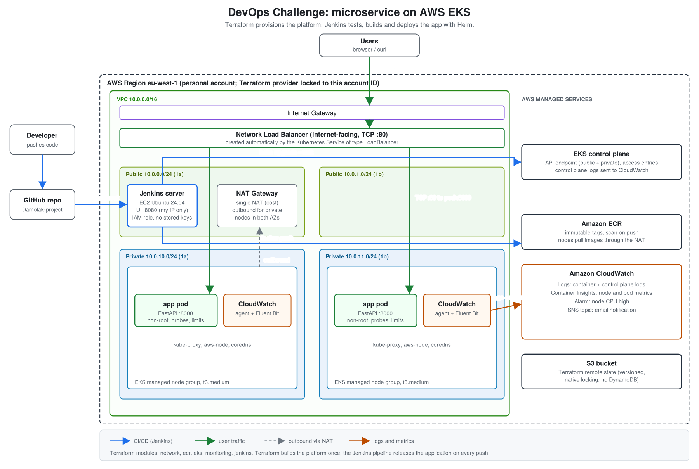
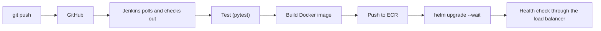

# Damolak Technologies DevOps Challenge: containerised microservice on AWS EKS

A small FastAPI microservice, deployed to **Amazon EKS** with a fully automated path from `git push` to a running release:

- **Terraform** builds the platform (network, container registry, Kubernetes cluster, monitoring, CI server).
- **Jenkins** tests, builds, pushes and deploys the application on every change.
- **Helm** releases the application onto the cluster.
- **CloudWatch** collects logs and metrics and sends an email alert when nodes run hot.

> **Environment status:** the AWS resources were deleted on 10 November 2026 to avoid ongoing cost, so there is no live endpoint. Evidence of the working deployment is in [`evidence/`](evidence/). The whole environment can be recreated from this repository by following [Deployment steps](#4-deployment-steps).

## Contents

1. [Architecture overview](#1-architecture-overview)
2. [Repository structure](#2-repository-structure)
3. [The application](#3-the-application)
4. [Deployment steps](#4-deployment-steps)
5. [CI/CD pipeline](#5-cicd-pipeline)
6. [Monitoring and logging](#6-monitoring-and-logging)
7. [Design decisions](#7-design-decisions)
8. [Security](#8-security)
9. [Assumptions](#9-assumptions)
10. [Limitations and improvements](#10-limitations-and-improvements)
11. [Cost and teardown](#11-cost-and-teardown)

---

## 1. Architecture overview



*Source: [`docs/architecture.svg`](docs/architecture.svg)*

### Components

| Layer | What | Where it is defined |
|---|---|---|
| Network | VPC `10.0.0.0/16`, two public and two private subnets across two Availability Zones, internet gateway, one NAT gateway | `terraform/modules/network` |
| Registry | ECR repository with immutable tags, scan on push and a lifecycle rule | `terraform/modules/ecr` |
| Compute | EKS cluster and a managed node group in the private subnets | `terraform/modules/eks` |
| Monitoring | CloudWatch Observability add-on, SNS email topic and a CPU alarm | `terraform/modules/monitoring` |
| CI server | Jenkins on EC2 with an IAM role, security groups and cluster access | `terraform/modules/jenkins` |
| Application release | Helm chart: Deployment and Service | `helm/devops-challenge-app` |
| Pipeline | Test, build, push and deploy | `Jenkinsfile` |

### Two flows

**Request path.** A user reaches the internet-facing **Network Load Balancer**. It forwards TCP port 80 to the application pods on port 8000. The pods run on worker nodes in **private subnets**, so they have no public IP address.

**Delivery path.**



### Division of responsibility

| Tool | Responsible for | Runs |
|---|---|---|
| Terraform | The platform: things that change rarely | Once, from an operator machine |
| Jenkins and Helm | The application: things that change often | On every push |

Because of this split, a code change can never modify the VPC or the cluster.

---

## 2. Repository structure

```
.
├── Jenkinsfile                     # CI/CD pipeline
├── app/                            # FastAPI microservice
│   ├── main.py
│   ├── Dockerfile
│   ├── requirements.txt            # runtime dependencies
│   ├── requirements-prod.txt       # runtime and test dependencies (used by the Jenkins Test stage)
│   └── tests/
├── helm/devops-challenge-app/      # Helm chart for the application
│   ├── Chart.yaml
│   ├── values.yaml
│   └── templates/                  # deployment.yaml, service.yaml
├── terraform/
│   ├── modules/                    # reusable building blocks
│   │   ├── network/
│   │   ├── ecr/
│   │   ├── eks/
│   │   ├── monitoring/
│   │   └── jenkins/
│   └── envs/
│       └── production/             # calls the modules; the only place you run terraform
├── docs/
│   └── architecture.png / .svg     # architecture diagram
└── pictures/                       # screenshots of the working deployment
```

Each Terraform module has the same three files: `variables.tf` (inputs), `main.tf` (resources) and `outputs.tf` (values handed to other modules). The environment folder only wires modules together, so a second environment would be another folder that calls the same modules with different values.

---

## 3. The application

A stateless FastAPI service. It keeps no data, so any number of replicas can serve any request.

| Endpoint | Purpose |
|---|---|
| `GET /` | Message, version (the build tag), environment and the pod name that answered |
| `GET /info` | Version, pod name and uptime |
| `GET /api/v1/greet?name=` | Example API endpoint with input validation (invalid input returns 422) |
| `GET /health` | **Liveness** probe: Kubernetes restarts the pod if this fails |
| `GET /ready` | **Readiness** probe: Kubernetes stops sending traffic if this fails (it does while the pod shuts down) |
| `GET /metrics` | Prometheus-format request counts and latency |
| `GET /docs` | Interactive API documentation generated by FastAPI |

Built for Kubernetes:

- Configuration comes from environment variables (`APP_VERSION`, `ENVIRONMENT`, `LOG_LEVEL`).
- Logs are **one JSON object per line** on stdout, including a request ID, status and duration.
- The container runs as a **non-root user** (UID 10001).
- The image version is stamped at build time, so `/` always shows which release is running.

Run it locally:

```bash
cd app
python3 -m venv .venv && . .venv/bin/activate
pip install -r requirements-prod.txt     # runtime packages plus pytest and httpx
pytest                                   # 9 tests
uvicorn main:app --port 8000
```

---

## 4. Deployment steps

### Prerequisites

- An AWS account and an AWS CLI profile for it (examples use `personal-challenge`)
- Terraform **1.10 or newer**, AWS CLI v2, and a GitHub repository for this code

### Step 1: Confirm you are in the right AWS account

```bash
export AWS_PROFILE=personal-challenge
aws sts get-caller-identity --query Account --output text
```

Terraform is also locked to one account through `allowed_account_ids`, so it refuses to run anywhere else.

### Step 2: Create the Terraform state bucket (one time)

Terraform stores its state in S3. The bucket must exist first, because Terraform cannot create its own backend.

```bash
ACCOUNT_ID=$(aws sts get-caller-identity --query Account --output text)
BUCKET=devops-challenge-tfstate-$ACCOUNT_ID

aws s3api create-bucket --bucket "$BUCKET" --region eu-west-1 \
  --create-bucket-configuration LocationConstraint=eu-west-1
aws s3api put-bucket-versioning --bucket "$BUCKET" --versioning-configuration Status=Enabled
aws s3api put-public-access-block --bucket "$BUCKET" \
  --public-access-block-configuration BlockPublicAcls=true,IgnorePublicAcls=true,BlockPublicPolicy=true,RestrictPublicBuckets=true
```

Put the bucket name in `terraform/envs/production/backend.tf`. Backend blocks cannot use variables, so it is written out. Locking uses S3's native lock file (`use_lockfile = true`), so no DynamoDB table is needed.

### Step 3: Configure the environment

Create `terraform/envs/production/terraform.tfvars` (git-ignored):

```hcl
aws_account_id       = "123456789012"          # your account ID
aws_profile          = "personal-challenge"
region               = "eu-west-1"
environment          = "prod"
kubernetes_version   = "1.37"                  # check: aws eks describe-cluster-versions --region eu-west-1
jenkins_allowed_cidr = "203.0.113.10/32"       # your public IP: curl ifconfig.me
alert_email          = "you@example.com"
```

### Step 4: Build the platform

```bash
cd terraform/envs/production
terraform init
terraform plan -out=tfplan
terraform apply tfplan
```

This takes roughly 15 minutes. It creates the network, ECR, EKS (with the node group), the monitoring module and the Jenkins server, including its IAM role, its cluster access and the security-group rule that lets it reach the Kubernetes API. Note the outputs: `jenkins_url`, `ecr_repository_url` and `kubeconfig_command`.

Confirm the SNS subscription email so alarm notifications are delivered.

### Step 5: First-time Jenkins setup (the only manual step)

1. Wait about five minutes for the server's startup script to finish, then open `jenkins_url`.
2. Get the unlock password from the server (EC2 console, Connect, Session Manager):
   `sudo cat /var/lib/jenkins/secrets/initialAdminPassword`
3. Install the suggested plugins and create an admin user.
4. Create a **Pipeline** job: *Pipeline script from SCM*, Git, this repository's URL, your branch, script path `Jenkinsfile`.

This is initial configuration of the CI tool itself. Everything after it is automated. See [Limitations](#10-limitations-and-improvements) for how to remove it.

### Step 6: Deploy

Click **Build Now**, or push a commit and Jenkins picks it up on its next poll. The pipeline tests, builds, pushes and deploys with no further input.

### Step 7: Verify

```bash
URL=http://<load-balancer-address>   # from: kubectl get svc app -n app
curl $URL/                          # version equals the Jenkins build tag
curl $URL/info                      # repeat: the hostname alternates between the pods
curl "$URL/api/v1/greet?name=Dera"
curl $URL/health

aws eks update-kubeconfig --name devops-challenge-prod-eks --region eu-west-1
kubectl get pods -n app             # two pods, Running
kubectl get svc app -n app          # the load balancer address
```

To demonstrate the automated release, change the message in `app/main.py`, push, and watch the version change at the URL. Kubernetes starts a new pod and waits for it to be ready before removing an old one, so nothing is dropped during the rollout.

---

## 5. CI/CD pipeline

Defined in [`Jenkinsfile`](Jenkinsfile). Any failing stage stops the pipeline, so a broken change never reaches the cluster.

| Stage | What it does |
|---|---|
| **Checkout** | Pulls the code and creates the image tag `<build-number>-<git-sha>` |
| **Test** | Creates a virtual environment, installs dependencies and runs `pytest` |
| **Build image** | `docker build` with the tag stamped into the image |
| **Push image** | Logs in to ECR with the server's IAM role and pushes the image |
| **Deploy** | `helm upgrade --install --wait`, then calls `/health` through the load balancer |
| **Post** | Prunes old images and cleans the workspace |

Points worth noting:

- **No stored credentials.** Jenkins gets AWS access from the IAM role attached to its EC2 instance.
- **Unique, immutable tags.** The build number is part of the tag, so a re-run never collides with an earlier image in ECR.
- **`--wait` makes the deploy honest.** Helm reports success only when the new pods pass their readiness probe, and the pipeline then confirms the live endpoint answers.
- **Rollback:** `helm rollback app -n app`, or re-run an earlier build.

---

## 6. Monitoring and logging

| Signal | How it is collected | Where to look |
|---|---|---|
| Container logs | Fluent Bit (CloudWatch Observability add-on) | CloudWatch log group `/aws/containerinsights/devops-challenge-prod-eks/application` |
| Node and pod metrics | CloudWatch agent (same add-on) | CloudWatch, Container Insights |
| Control-plane logs | EKS (`api`, `audit`, `authenticator`) | Log group `/aws/eks/devops-challenge-prod-eks/cluster` |
| Alert | CloudWatch alarm on average node CPU above 80%, sent through SNS to email | CloudWatch, Alarms |
| Application metrics | `/metrics` endpoint (request count and latency by route) | Direct request |

Because the application writes JSON logs, they can be queried in **CloudWatch Logs Insights**, for example to find failed requests:

```
fields @timestamp, log
| filter log like /"status": 4/ or log like /"status": 5/
| sort @timestamp desc
| limit 20
```

---

## 7. Design decisions

| Decision | Reasoning |
|---|---|
| **EKS** | Kubernetes is the common standard, which keeps the application portable. Rolling updates, health probes and self-healing come built in, and the same chart works on any cluster. |
| **Terraform for the platform, Helm for the application** | Each tool does what it is best at. Infrastructure changes rarely and is reviewed with `plan`. Application releases change often and need simple rollbacks. A code push cannot touch the VPC or the cluster. |
| **Modules per concern** | Small modules with explicit inputs and outputs are easy to read, reuse and test in isolation. |
| **Private worker nodes** | Pods are not reachable from the internet. Only the load balancer is public. |
| **Single NAT gateway** | Keeps cost down for this exercise. The trade-off is listed under limitations. |
| **EKS access entries (API authentication mode)** | The current replacement for the `aws-auth` ConfigMap. Access is granted in Terraform, so it is reviewable and repeatable. |
| **Jenkins uses an instance IAM role** | No access keys to store, rotate or leak. |
| **Jenkins UI limited to one IP, and polling instead of webhooks** | GitHub cannot reach a server that only accepts one address, so Jenkins polls. This is safer than opening the UI to the internet. |
| **Immutable ECR tags with build-number-plus-SHA** | Every release maps to exactly one image, and a tag can never be silently overwritten. |
| **S3 state with native locking** | Remote, versioned, encrypted state with locking and no extra table to manage. |
| **Network Load Balancer** | Created by the Kubernetes Service with a single annotation, so it needs no extra controller to install. It operates at layer 4. See the ALB item under improvements. |
| **Liveness and readiness are separate endpoints** | A pod can be alive but not ready (for example while shutting down). The two probes answer different questions. |
| **Stateless service** | Every replica is identical, so scaling and rolling updates are trivial. |

---

## 8. Security

- Terraform's AWS provider is locked to one account ID (`allowed_account_ids`).
- Worker nodes sit in private subnets with no public IP addresses.
- The Jenkins UI accepts traffic from a single IP address, and Jenkins can reach the Kubernetes API only through a security-group rule that names its own group.
- The Jenkins instance requires IMDSv2 and has shell access through Session Manager, so no SSH port is open.
- Containers run as a non-root user and cannot escalate privileges; capabilities are dropped.
- ECR scans images on push and tags are immutable.
- Terraform state is stored encrypted in a versioned bucket with public access blocked.
- No secrets are committed: `terraform.tfvars` and state files are git-ignored.

---

## 9. Assumptions

- A single environment (named `prod`) is deployed. The Terraform layout would support more by adding another folder under `terraform/envs/`.
- The AWS account has the permissions to create the listed resources, and the chosen region is `eu-west-1`.
- The Kubernetes version in `terraform.tfvars` is currently offered by EKS in that region.
- The operator's IP address is stable enough for the Jenkins security group, and is updated and re-applied if it changes.
- Plain HTTP is acceptable for the demo because no domain name or certificate is available.
- Jenkins is treated as the delivery tool for the application. Its first-run setup (unlock, plugins, job) is done by hand.

---

## 10. Limitations and improvements

| Limitation | Improvement |
|---|---|
| **One NAT gateway**: an outage in its Availability Zone would stop image pulls and outbound traffic for private nodes | One NAT gateway per Availability Zone |
| **HTTP only**, and the load balancer is a layer-4 NLB | AWS Load Balancer Controller with an ALB Ingress, an ACM certificate for HTTPS, a Route 53 domain and AWS WAF |
| **Public Kubernetes API endpoint** (private access is also enabled) | Restrict `public_access_cidrs`, or go private-only with Jenkins inside the VPC |
| **Jenkins has cluster-admin** so that Helm can create the namespace | Create the namespace in Terraform and grant Jenkins a namespace-scoped edit role |
| **First Jenkins login is manual** (unlock, plugins, job) | Jenkins Configuration as Code to define the plugins, admin user and job in files |
| **Jenkins is a single server** with local state on its disk | Back up Jenkins home, or move to ephemeral build agents |
| **No autoscaling**: fixed node count and replica count | Horizontal Pod Autoscaler plus Karpenter or Cluster Autoscaler |
| **Basic alerting**: one CPU alarm | Alarms for memory, pod restarts, 5xx rate and load-balancer health; dashboards |
| **`/metrics` is publicly reachable** and nothing scrapes it yet | Restrict it, and scrape with Prometheus or the CloudWatch agent's Prometheus support |
| **Log groups have no retention limit** (so cost grows) | Set a retention period on application and control-plane log groups |
| **Single environment** | Add staging, with a manual approval step before production in the pipeline |
| **Terraform is not run from CI** | A pipeline that runs `terraform plan` on pull requests and applies after approval |

---

## 11. Cost and teardown

The EKS control plane, the worker nodes, the NAT gateway, the load balancer and the Jenkins instance all bill while they exist, whether or not they are in use. Set an AWS billing alert, and destroy the environment when it is not needed.

**Order matters.** The load balancer is created by Kubernetes (through Helm), not by Terraform, so remove the release first. Otherwise it is left behind and blocks the VPC deletion.

```bash
aws eks update-kubeconfig --name devops-challenge-prod-eks --region eu-west-1
helm uninstall app -n app          # removes the NLB that Kubernetes created
# wait about a minute, then:
cd terraform/envs/production
terraform destroy
```

ECR is configured with `force_delete`, so images do not block the destroy. The state bucket is intentionally outside Terraform and is deleted separately (empty all versions first) if it is no longer needed.
